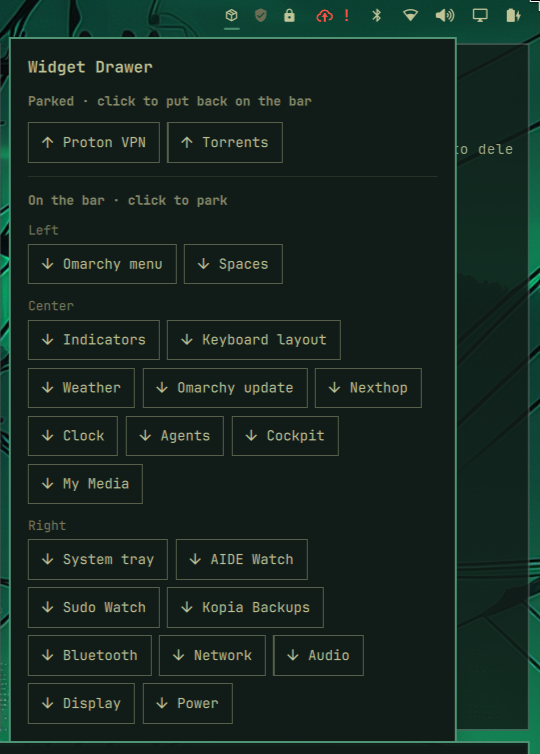

# Widget Drawer

An Omarchy bar widget that holds the widgets you aren't using right now.
Park a widget and it comes off the bar; its plugin stays installed and
enabled, so background services, alerts and notifications keep running. One
click puts it back.



## Install

Requires Omarchy with the Quickshell bar (`omarchy-shell`). `bin/drawerctl`
uses `jq` and Omarchy's own `omarchy-shell-config` and
`omarchy-plugin-catalog`, all of which ship with Omarchy. No other
dependencies.

```sh
omarchy plugin add https://github.com/TaylorBurke/widget-drawer.git --enable
```

The drawer icon lands in the right section of the bar. Move it like any other
widget, by dragging it or with `omarchy bar move taylorburke.widget-drawer`.

## Usage

Click the drawer icon to open it. It lists the widgets you've parked, each with
its icon and name. Click one to put it back on the bar, just after the drawer
icon, then drag it to wherever you want it.

The icon fills in while anything is parked, and its tooltip shows how many.

### Drag to park

Open the drawer and drag any icon from the bar onto it. The drop zone lights up
and says "Release to park" while the icon is over it; let go and the widget is
parked, settings included. (The bar would normally delete a widget released off
the strip. The drawer catches it instead, only when you release over the card.)

You can also drop an icon into the tray's drawer, the one that opens beside the
tray while you drag; it is parked a moment later. That needs the tray on the
bar. To turn off both, clear "Park widgets dropped in the tray drawer" in the widget's settings.

## How it works

Parked widgets are stored in a `parked` array on the drawer's own entry in
`~/.config/omarchy/shell.json`, with each widget's full layout entry, so its
settings come back intact when you restore it:

```json
{ "id": "taylorburke.widget-drawer", "parked": [ { "id": "widget.torrents" } ] }
```

Every change goes through `bin/drawerctl`, which writes `shell.json` the same
way `omarchy bar` does (Omarchy's `omarchy-shell-config` helper: atomic write,
then a shell config reload). You can use it from a terminal too:

```sh
drawerctl list               # JSON: widgets on the bar and in the drawer
drawerctl park <widget-id>
drawerctl restore <widget-id>
drawerctl park-tray          # park everything sitting in the tray drawer
```

## Limitations

- Parked widgets are listed by name; they don't run inside the drawer. Omarchy
  isolates third-party plugins from one another, so one widget can't host
  another's live UI.
- You can't drop a widget directly onto the drawer icon: the bar handles drags
  itself and exposes no drop target to plugins. Dropping onto the open drawer
  or into the tray drawer is the workaround.
- Parked widgets' icons are read from the widget's own QML (the first icon
  character in it). Widgets with none show a generic icon.
- Removing the drawer from the bar removes its entry, and with it the parked
  list. Restore anything you want to keep first.

## Uninstall

Restore any parked widgets, then:

```sh
omarchy plugin remove taylorburke.widget-drawer
```

## License

MIT
