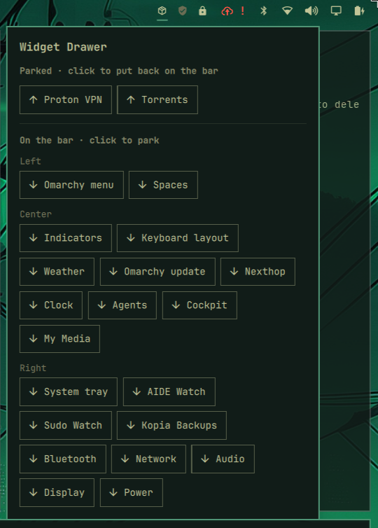

# Widget Drawer

An Omarchy bar widget that holds the widgets you aren't using right now.
Park a widget and it comes off the bar; its plugin stays installed and
enabled, so background services, alerts and notifications keep running. One
click puts it back.



## Install

Requires Omarchy with the Quickshell bar (`omarchy-shell`). `bin/drawerctl`
uses `jq` and Omarchy's own `omarchy-shell-config` and
`omarchy-plugin-catalog`, all of which ship with Omarchy. No other
dependencies.

```sh
omarchy plugin add https://github.com/TaylorBurke/widget-drawer.git --enable
```

The drawer icon lands in the right section of the bar. Move it like any other
widget, by dragging it or with `omarchy bar move taylorburke.widget-drawer`.

## Usage

Click the drawer icon to open its tile:

- **Parked**: widgets you've put away. Click one to put it back on the bar,
  just after the drawer icon. Drag it from there to wherever you want it.
- **On the bar**: everything currently on the bar, grouped by Left, Center and
  Right in bar order. Click one to park it.

The icon fills in while anything is parked, and its tooltip shows how many.

## How it works

Parked widgets are stored in a `parked` array on the drawer's own entry in
`~/.config/omarchy/shell.json`, with each widget's full layout entry, so its
settings come back intact when you restore it:

```json
{ "id": "taylorburke.widget-drawer", "parked": [ { "id": "widget.torrents" } ] }
```

Every change goes through `bin/drawerctl`, which writes `shell.json` the same
way `omarchy bar` does (Omarchy's `omarchy-shell-config` helper: atomic write,
then a shell config reload). You can use it from a terminal too:

```sh
drawerctl list               # JSON: widgets on the bar and in the drawer
drawerctl park <widget-id>
drawerctl restore <widget-id>
```

## Limitations

- Parked widgets are listed by name; they don't run inside the drawer. Omarchy
  isolates third-party plugins from one another, so one widget can't host
  another's live UI.
- Parking is click-based rather than drag-and-drop, for the same reason: bar
  drag state isn't exposed to plugins.
- Removing the drawer from the bar removes its entry, and with it the parked
  list. Restore anything you want to keep first.

## Uninstall

Restore any parked widgets, then:

```sh
omarchy plugin remove taylorburke.widget-drawer
```

## License

MIT
